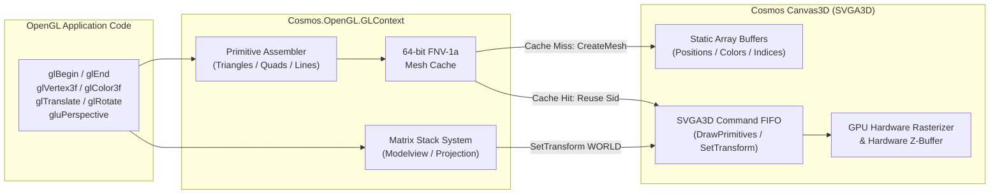

# Cosmos.OpenGL

[](https://www.nuget.org/)
[](https://dotnet.microsoft.com/)
[](https://github.com/CosmosOS/Cosmos)
[](https://github.com/CosmosOS/Cosmos)

A fully standalone, exact **OpenGL 1.x / 2.x** immediate-mode rendering library for **Cosmos OS**, powered by hardware-accelerated **`Canvas3D`** (VMware SVGA II / SVGA3D).

`Cosmos.OpenGL` brings the familiar OpenGL immediate-mode API (`glBegin`, `glEnd`, `glVertex`, `glColor`, `glTranslate`, `glRotate`, `gluPerspective`, `gluLookAt`) to Cosmos C# operating systems. It enables existing legacy OpenGL games, retro 3D graphics engines, and scientific visualizers to run directly on bare-metal or virtualized Cosmos hardware with 60 FPS hardware acceleration.

---

## Features

- **Standard OpenGL 1.x/2.x Immediate Mode**:
  - `glBegin` / `glEnd` support for all standard primitive types:
    - `GL_POINTS`, `GL_LINES`, `GL_LINE_STRIP`, `GL_LINE_LOOP`
    - `GL_TRIANGLES`, `GL_TRIANGLE_STRIP`, `GL_TRIANGLE_FAN`
    - `GL_QUADS`, `GL_QUAD_STRIP`, `GL_POLYGON`
  - Immediate vertex attributes: `glVertex3f`, `glColor3f`, `glColor4f`, `glNormal3f`, `glTexCoord2f`, and vector/pointer overloads.
- **Hardware-Accelerated Matrix Stacks**:
  - `GL_MODELVIEW`, `GL_PROJECTION`, `GL_TEXTURE` with 32-depth push/pop stacks.
  - `glLoadIdentity`, `glTranslatef`, `glRotatef`, `glScalef`, `glMultMatrix`, `glLoadMatrix`.
  - Math utilities: `gluPerspective`, `gluLookAt`, `gluOrtho2D`, `glFrustum`, `glOrtho`.
- **64-bit FNV-1a Vertex Buffer Caching**:
  - Geometry is hashed via bitwise FNV-1a across vertex coordinates, vertex colors, UVs, and indices.
  - Repetitive geometry (e.g. rotating models, game entities, terrain chunks) is uploaded to SVGA3D VRAM once and drawn via cached handles with **0 CPU-GPU sync stalls** and **0 per-frame surface allocations**.
- **Safe Deferred Lifecycle & GPU Synchronization**:
  - Dynamic meshes are retired cleanly across frames and evicted only after GPU hardware fences have synced, preventing surface destruction races during command stream execution.
- **Hardware Depth Testing & Blending**:
  - 16-bit hardware Z-buffering with `GL_DEPTH_TEST`, `glDepthFunc` (`GL_LESS`, `GL_LEQUAL`, `GL_GREATER`, etc.), and `glDepthMask`.
  - Alpha blending states (`GL_BLEND`, `glBlendFunc`).
- **Texture Mapping**:
  - `GL_TEXTURE_2D`, `glBindTexture`, `glTexImage2D`, `glGenTextures`, `glDeleteTextures`.
- **Fixed-Function Lighting**:
  - `GL_LIGHTING`, up to 8 lights (`GL_LIGHT0` .. `GL_LIGHT7`), ambient, diffuse, specular, and Gouraud shading.
- **Drop-in Compatibility**:
  - Compatible with OpenTK, Silk.NET, and classic C OpenGL syntax. Usable in **any** Cosmos C# project.

---

## Installation

You can reference `Cosmos.OpenGL` in your Cosmos OS project in two ways:

### Option A: Project Reference
Add a reference to `Cosmos.OpenGL.csproj` in your kernel's `.csproj`:

```xml
<ItemGroup>
  <ProjectReference Include="..\Libraries\Cosmos.OpenGL\Cosmos.OpenGL.csproj" />
</ItemGroup>
```

### Option B: NuGet Package
Add the package reference to your kernel's `.csproj`:

```xml
<ItemGroup>
  <PackageReference Include="Cosmos.OpenGL" Version="1.0.0" />
</ItemGroup>
```

---

## Quick Start

### 1. Initializing the 3D Context

Call `GL.Initialize()` with your active `Canvas3D` instance (or let it auto-detect):

```csharp
using Cosmos.Kernel.System.Graphics;
using Cosmos.Kernel.System.Graphics.Rendering3D;
using Cosmos.OpenGL;

// Initialize hardware 3D Canvas
var canvas3D = Canvas.GetFullScreen(new Mode(1920, 1080, ColorDepth.ColorDepth32)) as Canvas3D;
if (canvas3D != null)
{
    GL.Initialize(canvas3D);
}
```

### 2. Spinning 3D Pyramid & Cube (Immediate Mode)

```csharp
using Cosmos.OpenGL;

public void RenderLoop()
{
    // Setup Perspective Viewport
    GL.Viewport(0, 0, 1920, 1080);
    GL.MatrixMode(MatrixMode.Projection);
    GL.LoadIdentity();
    GLU.gluPerspective(60.0, 1920.0 / 1080.0, 0.1, 100.0);

    GL.Enable(EnableCap.DepthTest);
    GL.DepthFunc(DepthFunction.Less);

    float rotation = 0.0f;

    while (true)
    {
        // Clear Color & Depth
        GL.ClearColor(0.05f, 0.08f, 0.15f, 1.0f);
        GL.Clear(ClearBufferMask.ColorBufferBit | ClearBufferMask.DepthBufferBit);

        // ---------------------------------------------------------
        // 1. Spinning Color Pyramid (Triangles)
        // ---------------------------------------------------------
        GL.MatrixMode(MatrixMode.Modelview);
        GL.LoadIdentity();
        GL.Translate(-2.0f, 0.0f, -7.0f);
        GL.Rotate(rotation, 0.0f, 1.0f, 0.0f);

        GL.Begin(PrimitiveType.Triangles);
        {
            // Front Face
            GL.Color3f(1.0f, 0.0f, 0.0f); GL.Vertex3f( 0.0f,  1.0f,  0.0f);
            GL.Color3f(0.0f, 1.0f, 0.0f); GL.Vertex3f(-1.0f, -1.0f,  1.0f);
            GL.Color3f(0.0f, 0.0f, 1.0f); GL.Vertex3f( 1.0f, -1.0f,  1.0f);

            // Right Face
            GL.Color3f(1.0f, 0.0f, 0.0f); GL.Vertex3f( 0.0f,  1.0f,  0.0f);
            GL.Color3f(0.0f, 0.0f, 1.0f); GL.Vertex3f( 1.0f, -1.0f,  1.0f);
            GL.Color3f(0.0f, 1.0f, 0.0f); GL.Vertex3f( 1.0f, -1.0f, -1.0f);

            // Back Face
            GL.Color3f(1.0f, 0.0f, 0.0f); GL.Vertex3f( 0.0f,  1.0f,  0.0f);
            GL.Color3f(0.0f, 1.0f, 0.0f); GL.Vertex3f( 1.0f, -1.0f, -1.0f);
            GL.Color3f(0.0f, 0.0f, 1.0f); GL.Vertex3f(-1.0f, -1.0f, -1.0f);

            // Left Face
            GL.Color3f(1.0f, 0.0f, 0.0f); GL.Vertex3f( 0.0f,  1.0f,  0.0f);
            GL.Color3f(0.0f, 0.0f, 1.0f); GL.Vertex3f(-1.0f, -1.0f, -1.0f);
            GL.Color3f(0.0f, 1.0f, 0.0f); GL.Vertex3f(-1.0f, -1.0f,  1.0f);
        }
        GL.End();

        // ---------------------------------------------------------
        // 2. Spinning Shaded Cube (Quads)
        // ---------------------------------------------------------
        GL.LoadIdentity();
        GL.Translate(2.0f, 0.0f, -7.0f);
        GL.Rotate(rotation * 0.7f, 1.0f, 1.0f, 0.5f);

        GL.Begin(PrimitiveType.Quads);
        {
            // Front (Red)
            GL.Color3f(1.0f, 0.0f, 0.0f);
            GL.Vertex3f( 1.0f,  1.0f, 1.0f);
            GL.Vertex3f(-1.0f,  1.0f, 1.0f);
            GL.Vertex3f(-1.0f, -1.0f, 1.0f);
            GL.Vertex3f( 1.0f, -1.0f, 1.0f);

            // Back (Yellow)
            GL.Color3f(1.0f, 1.0f, 0.0f);
            GL.Vertex3f( 1.0f, -1.0f, -1.0f);
            GL.Vertex3f(-1.0f, -1.0f, -1.0f);
            GL.Vertex3f(-1.0f,  1.0f, -1.0f);
            GL.Vertex3f( 1.0f,  1.0f, -1.0f);

            // Top (Green)
            GL.Color3f(0.0f, 1.0f, 0.0f);
            GL.Vertex3f( 1.0f, 1.0f, -1.0f);
            GL.Vertex3f(-1.0f, 1.0f, -1.0f);
            GL.Vertex3f(-1.0f, 1.0f,  1.0f);
            GL.Vertex3f( 1.0f, 1.0f,  1.0f);

            // Bottom (Orange)
            GL.Color3f(1.0f, 0.5f, 0.0f);
            GL.Vertex3f( 1.0f, -1.0f,  1.0f);
            GL.Vertex3f(-1.0f, -1.0f,  1.0f);
            GL.Vertex3f(-1.0f, -1.0f, -1.0f);
            GL.Vertex3f( 1.0f, -1.0f, -1.0f);

            // Left (Blue)
            GL.Color3f(0.0f, 0.0f, 1.0f);
            GL.Vertex3f(-1.0f,  1.0f,  1.0f);
            GL.Vertex3f(-1.0f,  1.0f, -1.0f);
            GL.Vertex3f(-1.0f, -1.0f, -1.0f);
            GL.Vertex3f(-1.0f, -1.0f,  1.0f);

            // Right (Violet)
            GL.Color3f(1.0f, 0.0f, 1.0f);
            GL.Vertex3f( 1.0f,  1.0f, -1.0f);
            GL.Vertex3f( 1.0f,  1.0f,  1.0f);
            GL.Vertex3f( 1.0f, -1.0f,  1.0f);
            GL.Vertex3f( 1.0f, -1.0f, -1.0f);
        }
        GL.End();

        // Present hardware frame buffer
        GL.SwapBuffers();

        rotation += 1.5f;
    }
}
```

---

## 3D Camera & Chase Cam (`gluLookAt`)

You can set up orbital or chase cameras using standard `gluLookAt` or direct vector camera manipulation:

```csharp
// Position camera at (0, 5, -10) looking towards the origin (0, 0, 0):
GLU.gluLookAt(
    0.0, 5.0, -10.0,  // Eye position (X, Y, Z)
    0.0, 0.0, 0.0,    // Target position (X, Y, Z)
    0.0, 1.0, 0.0     // Up vector (X, Y, Z)
);
```

---

## Texturing

```csharp
// 1. Generate & bind a texture object
int texId = GL.GenTexture();
GL.BindTexture(TextureTarget.Texture2D, texId);

// 2. Load texture using Cosmos Canvas3D Texture
Texture hwTexture = canvas3D.CreateTexture(myBitmapImage);
GL.RegisterTexture(texId, hwTexture);

// 3. Render textured quad
GL.Enable(EnableCap.Texture2D);
GL.Begin(PrimitiveType.Quads);
{
    GL.TexCoord2f(0.0f, 0.0f); GL.Vertex3f(-1.0f, -1.0f, 0.0f);
    GL.TexCoord2f(1.0f, 0.0f); GL.Vertex3f( 1.0f, -1.0f, 0.0f);
    GL.TexCoord2f(1.0f, 1.0f); GL.Vertex3f( 1.0f,  1.0f, 0.0f);
    GL.TexCoord2f(0.0f, 1.0f); GL.Vertex3f(-1.0f,  1.0f, 0.0f);
}
GL.End();
GL.Disable(EnableCap.Texture2D);
```

---

## Architecture & Hardware Pipeline



### Why FNV-1a Vertex Caching Matters on Cosmos
On Cosmos OS, `Canvas3D` communicates with the graphics hardware via PCI DMA array buffers. Creating and destroying meshes every frame requires allocating scratch VRAM, issuing DMA, and synchronizing PCI fences (`SyncToFence`), which causes CPU-GPU stalling.

`Cosmos.OpenGL` solves this with a **zero-allocation FNV-1a mesh cache**:
1. Staged vertex buffers are hashed across coordinates, colors, UVs, and indices.
2. Recurring geometry is retained directly in hardware VRAM.
3. Subsequent frames only dispatch lightweight `SetTransform` and `DrawPrimitives` FIFO commands.
4. Transient dynamic geometry not reused for $\ge 2$ frames is safely retired and disposed after hardware fences have synced.

---

## API Coverage Summary

| Category | Supported Functions |
|---|---|
| **Drawing Primitives** | `glBegin`, `glEnd`, `glVertex2f`, `glVertex3f`, `glVertex4f`, `glVertex3d`, `glVertex3fv` |
| **Color Attributes** | `glColor3f`, `glColor4f`, `glColor3ub`, `glColor4ub`, `glColor` (System.Drawing.Color) |
| **Normals & UVs** | `glNormal3f`, `glNormal3fv`, `glTexCoord2f`, `glTexCoord2fv` |
| **Matrix Manipulation** | `glMatrixMode`, `glLoadIdentity`, `glTranslatef`, `glRotatef`, `glScalef`, `glPushMatrix`, `glPopMatrix`, `glMultMatrix`, `glLoadMatrix` |
| **Projections & Views** | `gluPerspective`, `gluLookAt`, `gluOrtho2D`, `glFrustum`, `glOrtho`, `glViewport` |
| **Depth & Clear** | `glClearColor`, `glClearDepth`, `glClear`, `glDepthFunc`, `glDepthMask` |
| **Capabilities** | `glEnable`, `glDisable`, `glIsEnabled` (`GL_DEPTH_TEST`, `GL_TEXTURE_2D`, `GL_BLEND`, `GL_CULL_FACE`, `GL_LIGHTING`) |
| **Textures** | `glGenTextures`, `glBindTexture`, `glTexImage2D`, `glDeleteTextures`, `GL.RegisterTexture` |
| **Frame Presentation** | `glSwapBuffers`, `glFinish`, `glFlush` |
| **Queries** | `glGetIntegerv`, `glGetFloatv`, `glGetString`, `glGetError` |

---

## Contributing & License

`Cosmos.OpenGL` is part of the Windose OS project and released under the standard open-source license. Contributions, bug reports, and pull requests are welcome!
